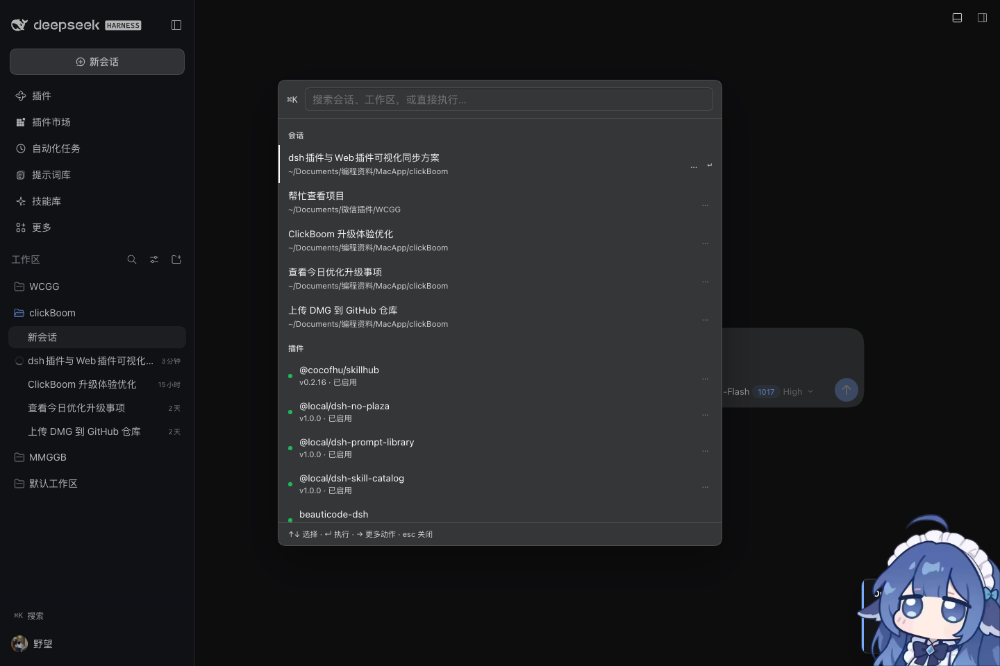

# dsh-cmdk — ⌘K 命令面板

当前版本 **0.3.0**：会话 / 工作区 / 插件 / 动作 / 外观一个入口，插件可扩展。

一个快捷键跳到任何东西：会话、工作区、常用动作，还能对选中的会话直接做事。
装完即用，无配置，零依赖。



## 能做什么

**打开**

| 输入 | 结果 |
| --- | --- |
| `⌘K` / `Ctrl+K` | 打开 / 关闭面板（侧栏底部也有「⌘K 搜索」按钮） |
| 输入会话标题 | 模糊匹配全部会话（前缀 > 子串 > 拼音首字母 > 子序列），回车直达 |
| 输入中文首字母 | `cj` → 「插件…」，`cjgc` → 「插件广场」 |
| 输入消息内容 | 宿主扫描最近 12 个会话的日志文本，带上下文片段 |
| 输入工作区名 | 直接切换工作区 |
| `深色` / `浅色` / `跟随系统` | 换主题 |
| `中文` / `English` | 换界面语言 |

**对一条会话按 `→`（或行尾的 `…`）可以**

打开 / 重命名 / Fork 到新会话 / 归档 / 复制会话 ID / 复制工作目录路径 /
在访达打开工作目录 / 导出为 Markdown（含图片轮与工具调用，落到下载目录）。

**插件**

面板里有一组「插件」：列出当前 profile 里所有已安装的插件，显示版本与启用状态；
回车切换启用 / 禁用（走 `pluginManager.setBundleEnabled`，失败自动回滚），
按 `→` 还能直接打开该插件在 `node_modules` 里的目录。

**对工作区按 `→` 可以**

切换、在此新建会话、在访达打开。

**系统**

打开 profile 目录、打开 sessions 目录、打开日志目录、刷新页面。

键盘：`↑` `↓` 选择、`↵` 执行、`→` 更多动作、`←`/`Esc` 返回上一层。

## 给别的插件用：注册自己的命令

任何 client 插件都可以往面板里塞一行（不用改本插件的代码）：

```js
window.__DSH_CMDK__?.register({
  id: 'my-plugin.open-docs',       // 唯一 id，重复注册会覆盖
  title: '打开插件文档',            // 会被模糊匹配 + 拼音首字母匹配
  sub: 'my-plugin 说明书',          // 副标题，也会参与匹配
  run: (ctx) => ({ status: '已打开' }), // 返回 { status } 面板保持打开，返回空则关闭
});
// 需要时再撤销
window.__DSH_CMDK__?.unregister('my-plugin.open-docs');
```

也可以用事件注册（适合早于本插件加载的模块）：
`window.dispatchEvent(new CustomEvent('dsh-cmdk:command', { detail: { id, title, run } }))`。

## 记忆

用过的动作会记在 `localStorage["dsh-cmdk/recent"]`（次数 + 时间，最多 60 条），
下次空查询时按使用频率排在最上面。纯本地，不上传。

## 设计取舍

- **跳转与动作走公开 Client 服务**：切会话、Fork、归档、重命名、换主题、换语言都用
  `uiWorkspace` / `sessions` / `theme` / `locale`，不碰内部模块。
- **列表数据走宿主**：浏览器侧拿不到"全部历史会话"和工作区清单，所以宿主读
  `sessionQuery.listSessions()` + `readTitleSnapshots()`（标题）与
  `~/.dsh/storages/workspace.json`（工作区、已归档会话），客户端只做展示。
- **内容搜索不依赖 SQLite 索引**：用 `filterEvents({kind:'text'})` 扫正文——实测有些
  机器上原生「搜索会话」本身就是空的（全文索引没建起来），照抄索引会一起空。
  代价是只扫最近 12 个会话，且只跳到会话顶部而不是那一条消息（API 不返回消息序号）。
- **拼音只支持首字母**：内置 20992 字符的首字母表（U+4E00–U+9FFF），`chajian` 这种全拼
  不匹配，`cj` 可以。全拼要 20 倍体积，先不做。
- **信任栅栏**：所有自定义路由都先过 `connection.requestRejection`，只在本机回环口可用。
- **插件开关复用宿主能力**：启用/禁用走 `pluginManager.setBundleEnabled`，不自己改
  `package.json`、不自己跑 pnpm；需要重启的会直接告诉你「重启后生效」。
- **视觉分层**：搜索框、列表、底部提示是三块不同表面（header 面板底色 + 1px 硬分隔 +
  内阴影输入框），分组标题吸顶，滚动时不会再和标题糊在一起。

## 路由

| 方法 | 路径 | 作用 |
| --- | --- | --- |
| GET | `/cmdk/info` | home / profile / platform |
| GET | `/cmdk/sessions?q=&limit=` | 会话目录 + 标题匹配 + 正文命中片段 |
| GET | `/cmdk/workspaces` | 工作区清单 + 已归档会话 ID |
| GET | `/cmdk/export?id=` | 把一段会话渲染成 Markdown |
| GET | `/cmdk/plugins` | 已安装插件（名称 / 版本 / 启用状态 / 目录） |
| POST | `/cmdk/plugin` | `{ name, enabled }` 启用或禁用某个插件 |
| POST | `/cmdk/open-profile` | 在访达/资源管理器打开目录（可选 `{path}`） |

## 安装

插件市场搜 `dsh-cmdk`，或本地目录安装：

```
dsh plugin --profile desktop add link:/Users/mumu/Documents/微信插件/DSH插件/cmdk2
```

装完重启桌面 app（或刷新页面）拿到新的 client 模块。

## 文件

```
package.json        # dsh.bundle.patch + dsh.client（platform web, immediately）
cordis.patch.yml    # insert: dsh-cmdk
index.js           # Host：/cmdk/{info,sessions,workspaces,plugins,plugin,export,open-profile}
client.js           # Client：shell.overlay 面板 + sidebar.footer.action 按钮
locale/zh.json      # meta.title / meta.description
locale/en.json
icon.svg
```

## License

MIT
